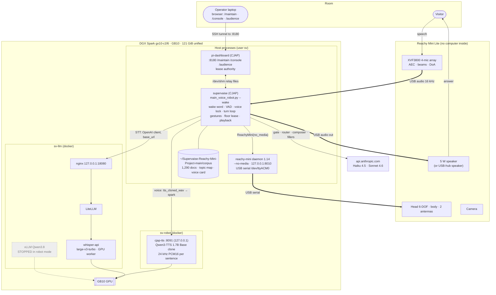
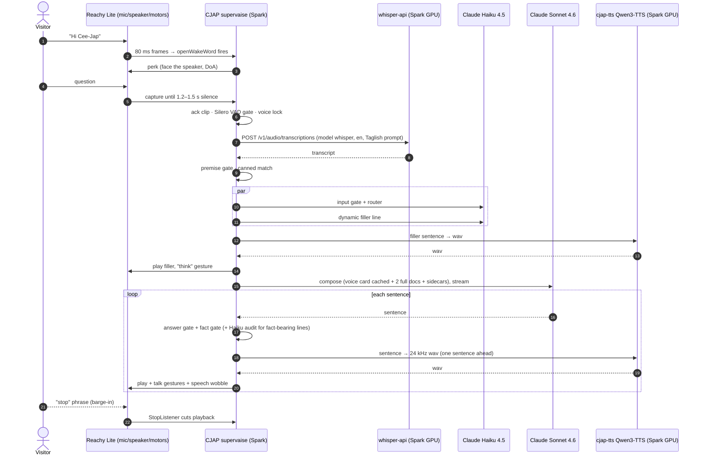

# CJAP on the DGX Spark: the Panganiban robot with local speech (`gx10-c1f6`)

> **Status:** Planned, not deployed. Written **2026-11-05** from the CJAP repository and a read-only probe of the Spark. Nothing here has run on the GB10 yet. Runbook: [`CJAP_SPARK_RUNBOOK.md`](RUNBOOK.md).
> **Basis:** [`Supervaise-Inc/CJAP`](https://github.com/Supervaise-Inc/CJAP), branch **`merge/master-single-robot`** at `1d986be` (2026-11-05, "Filler: no new clip once the answer is coming"). That branch is `master` (the 2026-09-29 alpha handover, knowledge base v2) plus the single-robot console and today's GStreamer sentence player.
> **Code:** branch **`spark/local-speech`** (three commits on `1d986be`: 8 small code changes, all off unless set, plus `deploy/spark/` and 12 tests). Built locally; `mabayawa` has read-only access to the repo, so it travels as a git bundle (`cjap-spark/`) until someone with push rights publishes it.
> **What it adds:** CJAP moves from the robot's Raspberry Pi onto the Spark, with a **Reachy Mini Lite on the Spark's USB-C**. Speech-to-text moves from OpenAI to the Spark's **Whisper API**, and Panganiban's voice moves from Fish Audio / ElevenLabs to a **Qwen3-TTS clone on the Spark's GPU**. Claude (Haiku gate/router/fillers, Sonnet composer) stays exactly as CJAP has it.

---

## Contents

1. [What this is](#1-what-this-is)
2. [What you decided](#2-what-you-decided)
3. [Where things are today](#3-where-things-are-today)
4. [Architecture](#4-architecture)
5. [What changes in CJAP, and what does not](#5-what-changes-in-cjap-and-what-does-not)
6. [Components on the Spark](#6-components-on-the-spark)
7. [Audio and the robot on the Spark](#7-audio-and-the-robot-on-the-spark)
8. [The voice clone](#8-the-voice-clone)
9. [Memory, GPU and robot mode](#9-memory-gpu-and-robot-mode)
10. [Latency](#10-latency)
11. [Venues: an open decision](#11-venues-an-open-decision)
12. [Security](#12-security)
13. [Risks](#13-risks)
14. [Open items](#14-open-items)
15. [Sources](#15-sources)

---

## 1. What this is

The goal is to run your four-stage pipeline on the Spark: speech to text, reasoning and retrieval over our own files, text to speech, and an avatar. CJAP already does the first three in production on the Pi, with cloud speech. This plan keeps CJAP's tested pipeline and moves the speech into the Spark.

| Your pipeline stage | CJAP today (alpha Pi, 2026-09-29) | On the Spark (this plan) |
|---|---|---|
| (1) ASR | OpenAI `gpt-4o-mini-transcribe`, with a Taglish steering prompt | The Spark's **whisper-api** (`whisper`, large-v3-turbo) through LiteLLM. Same OpenAI client, same prompt and `language` |
| (2) Retrieve context through reasoning | Haiku 4.5 input gate + premise gate + Haiku router over the 30-topic map → whole documents (1,290 docs, knowledge base v2) → **Sonnet 4.6 composer** in Panganiban's voice, per-sentence fact gates | **Unchanged.** Same models, prompts, corpus and gates |
| (3) TTS | Fish Audio clone only (`CJ_TTS_ORDER=fish`); ElevenLabs clone for fillers | **Qwen3-TTS clone on the GPU**, engine `spark`, `CJ_TTS_ORDER=spark`. No cloud voice |
| (4) Avatar | Reachy Mini body (breathing, gestures, speech wobble), plus an optional HeyGen LiveAvatar browser page | **Reachy Mini body only.** The LiveAvatar page is out of scope (left in the code, not configured) |

| Requirement | How it is met |
|---|---|
| Models live natively on the Spark | Whisper (STT) and Qwen3-TTS (voice) on the GB10. Only Claude stays in the cloud, by your choice |
| One voice in the room | CJAP's voice guard refuses any non-clone voice. The new engine is a clone of the same person, and `CJ_TTS_ORDER=spark` means silence rather than a different voice if it fails |
| Don't break what works | No change to `answer_pipeline.py`, the voice card, the router prompt or the corpus. CJAP's notes say the composer's prompt cache depends on those bytes |
| The robot on the Spark | A Reachy Mini **Lite** on USB-C. The Reachy daemon runs on the Spark; CJAP talks to it locally, as it did on the Pi |
| Hands-free, interruptible | CJAP's own wake word ("Hi Cee-Jap", `hi_see_jap.onnx`), voice lock, stop phrase and barge-in, unchanged |
| Operator control | CJAP's dashboard (`/maintain`, `/console`, `/audience`), now served by the Spark on **:8180** (8080/8443 are taken there), reached through an SSH tunnel |
| The office LLM API keeps working | `sv-robot on` stops vLLM Qwen; `sv-robot off` restores the saved split |

**Not in scope:** a talking-head video avatar (LiveAvatar, AVTR-1 etc.); upgrading Claude models; embeddings retrieval; a second robot; running the robot at a venue without the Spark (section 11).

---

## 2. What you decided

| Question | Your answer |
|---|---|
| Basis | **CJAP**, branch `merge/master-single-robot` |
| Where the app runs | **On the Spark**, with a Reachy Mini **Lite** on USB-C |
| ASR | **Reuse the Spark's whisper-api** (through LiteLLM) |
| LLM / retrieval | **CJAP's pipeline as it is**: Haiku 4.5 + Sonnet 4.6 over the curated topic map |
| TTS | **Local clone only**, no cloud fallback (`CJ_TTS_ORDER=spark`) |
| Clone source | **Now:** the ElevenLabs filler clips already in the clone voice. **Later:** a real recording of Justice Panganiban, if you can get one |
| Video avatar | **Dropped.** The robot body is the avatar |
| Qwen and the LLM stack | **Stop Qwen in robot mode**; keep LiteLLM and whisper-api running |
| Venue uplink, if the Spark travels | **Wired first, Wi-Fi or hotspot as fallback** |
| Does the Spark travel? | **Not decided; probably not.** See section 11 |

---

## 3. Where things are today

### CJAP (from the repository)

| Item | Value |
|---|---|
| Hardware | Reachy Mini **Wireless** `reachy-cjap` (alpha): Raspberry Pi CM4, ReachyMiniOS 0.2.3, Debian 13, Python 3.13.5, user `pollen`. Beta is retired in the single-robot branch |
| Services | `supervaise.service` (`app/main_voice_robot.py --wake`), `pi-dashboard.service` (:8080 dashboard + `/console` floor lease), `audio-hub.service` (USB hub mic/speaker), `bt-keepalive`, `wifi-fallback`; tuning in `supervaise.service.d/wakeword.conf` (50 `Environment=` lines) |
| Speech | STT OpenAI `gpt-4o-mini-transcribe`; TTS Fish Audio clone (`FISH_MODEL_ID 587a21e9…`), ElevenLabs clone (`ELEVEN_VOICE_ID LeM5jaQw…`) for fillers, duet and intros |
| Pipeline | `answer_pipeline.py` (gate, router, context, Sonnet composer), `speech_streaming.py` + `stream_speak.py` (per-sentence synthesis and playback), `answer_gate.py` + `premise_gate.py` (truthfulness gates) |
| Audio | ALSA names in `~/.asoundrc`: mic `reachymini_audio_src_plug` (XVF3800 beam, 16 kHz), speaker `audio_out_route`; GStreamer sentence player opt-in since today (`CJ_SENTENCE_PLAYER=gst`) |
| Robot body | `ReachyMini(media_backend="no_media")`: the SDK only moves the head and antennas; CJAP does its own audio |
| Tests | `app/.venv/bin/python -m pytest tests/`: 396 passing at the 09-29 handover (more since) |
| Known open items | Wake threshold override 0.5 probably too high; 245 of 1,290 docs unroutable; fidelity check off for latency; `lambino-case` gate rule |

### The Spark (read-only probe, 2026-11-05)

| Item | Value | Consequence |
|---|---|---|
| Host | Ubuntu 24.04.4, kernel 6.17 nvidia, aarch64 ×20, GB10 sm_121, driver 580.173.02, CUDA 13.0 | CJAP and the daemon are pure Python on aarch64; only the TTS needs the GPU stack |
| Memory | 121 GiB, ~50 GiB available; vLLM Qwen holds ~60 GiB (split qwen=50) | Robot mode frees the Qwen share |
| LLM stack `~/llm` | nginx (:58 public, **127.0.0.1:18080** admin), LiteLLM, postgres, vLLM, **whisper-api** (healthy, worker on demand) | STT reaches whisper-api through the admin port, like the load test did |
| Tools | Python 3.12.3, git, gstreamer, tmux, docker (sv in `docker` + `sudo`) | CJAP needs a 3.11–3.13 venv; 3.12 is fine |
| Audio | Only the NVIDIA HDMI audio output: **no capture device, no `/dev/video`** | The Lite brings both (USB audio "Reachy Mini Audio", camera) |
| Ports | **127.0.0.1:8000** and **192.168.1.201:8080 / :8443** are already in use (owners hidden without root) | The Reachy daemon's and CJAP dashboard's default ports: the daemon moves to 8010, the dashboard to 8180 / 8543 |
| Groups, sessions | sv not in `dialout` / `plugdev` / `audio`; PipeWire running in sv's session; linger off; no `uv`, no PortAudio | Owner step: groups, udev, linger, apt packages |
| Whisper | Never used for a real transcription yet | Runbook gate W proves it before CJAP depends on it |

---

## 4. Architecture

### How it lives on the Spark

- **Host processes, not containers, for CJAP and the daemon.** CJAP depends on ALSA device names, `/dev/shm` relay files shared with the dashboard, `~/bin` helper scripts and real-time audio priority. On the Pi they run as systemd services under one user, and the same shape on the Spark (user `sv`) keeps every path in CJAP's code and docs true.
- **The GPU work is in containers.** whisper-api is already there. The Qwen3-TTS server is a new container `cjap-tts`, built `FROM sv/whisper:1` so it reuses the torch 2.11 + CUDA 13 stack already built for the GB10.
- **Claude is the only internet dependency.** STT and voice no longer leave the box.

### One turn

The turn is CJAP's own (`docs/SYSTEM_TRACE.md` §3). Only the arrows to **W** and **T** are new; before, they went to OpenAI and Fish Audio.

---

## 5. What changes in CJAP, and what does not

The changes are small and sit at CJAP's existing seams: the OpenAI client for STT, and `tts_cloned_wav()` for the voice.

| File | Change | Why |
|---|---|---|
| `voice/qwen.py` | **New.** Client for the local TTS server, the same shape as `voice/fish.py`: `configured()`, `model_id()`, `synthesize(text, speed, words_out)` → 24 kHz float PCM through the same EQ chain | One more clone engine, with its own cache namespace |
| `app/speech_engines.py` | `engine_order()` accepts `spark`; `_synth_with()` routes it to the new `tts_spark_wav()` (a copy of `tts_fish_wav()` with the `spark` namespace). A transcript that LiteLLM returns as a JSON body is unwrapped | `CJ_TTS_ORDER=spark`; the JSON guard covers a known LiteLLM quirk (Whisper API risk A3) |
| `voice/config.py` | The ElevenLabs credentials are required only while `CJ_TTS_ORDER` lists `elevenlabs` | Without this, `import voice` raises on a machine with no ElevenLabs key, and the local clone could never load |
| `app/voice_guard.py` | `ENGINE_LABEL["spark"] = "Spark (Qwen3-TTS)"` | Dashboard and journal labels |
| `app/main_voice_robot.py` | `CJ_REACHY_PORT`: connect to the daemon on that port, localhost only | The daemon can't use 8000 on the Spark |
| `app/floor_lease.py`, `dashboard/console.py` | `CJ_ROBOTS_JSON`: another machine map | The lease authority is found by hostname; the Spark's map (`deploy/spark/robots.json`) names `gx10-c1f6` as alpha and authority without editing alpha's |
| `dashboard/ui_server.py` | `CJ_DASH_PORT`, `CJ_DASH_HTTPS_PORT` | 8080/8443 are taken on the Spark |
| `deploy/spark/` | systemd units, the Spark `wakeword.conf` (alpha's 48 settings with Spark paths, STT on Whisper, plus a Spark block), `.asoundrc`, `robots.json`, udev rules, `requirements-spark.txt`, `sv-robot`, the Whisper keepalive, the `cjap-tts` image and compose file, `tts_bench.py` | Everything the machine needs outside the app code, as `deploy/alpha/` is for alpha |
| `tests/test_spark_voice.py` | 12 tests for all of the above | Run with CJAP's suite |
| `app/.env` (not in git) | `ANTHROPIC_API_KEY`, a whisper-only LiteLLM key as `OPENAI_API_KEY`, `OPENAI_BASE_URL`, `OPENAI_STT_MODEL=whisper`, `CJ_TTS_ORDER=spark`, `CJ_QWEN_TTS_URL`; no Fish or ElevenLabs keys | STT and voice go local |

**Every switch is off unless set**, so the same branch still runs alpha unchanged. On the laptop, with the branch, the new tests plus `test_voice_guard`, `test_fish_words`, `test_speakable`, `test_gst_audio`, `test_filler_policy` and `test_api_keys` pass (130). The failures seen there (`test_name_pin`, one `test_dashboard_ui`, 7 timing tests in `test_floor_lease`) fail the same way on the unchanged base under Windows. Gate P runs the whole suite on the Spark.

**Not changed:** `answer_pipeline.py`, `corpus/` (voice card, router prompt, topic map, knowledge base v2), the gates, the wake model, the floor-lease logic, the dashboard pages. **Not used on the Spark:** `audio-hub`'s Pi-specific parts, `bt-keepalive`, `wifi-fallback`, `speaker-watchdog` (already disabled on alpha), the AEC reference feed for Bluetooth (`CJ_AEC_REF_FEED=0`), LiveAvatar.

**Every OpenAI call is STT.** CJAP's only other OpenAI path is the TTS fallback, and the voice guard refuses it. So pointing `OPENAI_BASE_URL` at the Spark moves STT without touching code, and an OpenAI key is no longer needed.

---

## 6. Components on the Spark

| Component | Where | Role |
|---|---|---|
| CJAP checkout | `~/Supervaise-Reachy-Mini-Project-main` (the path CJAP's dashboard and scripts expect), branch `spark/local-speech` | The app, dashboard, corpus, tests, `deploy/spark/` |
| CJAP venv | `app/.venv` (Python 3.12, made with `uv`) | `deploy/spark/requirements-spark.txt`: CJAP's requirements + `reachy-mini==1.14.0`, `soundfile`, `sherpa-onnx`, `audiotsm`, `langdetect`. `openwakeword` is installed `--no-deps` (its `tflite-runtime` has no Python 3.12 aarch64 wheel; CJAP uses the ONNX model). PyGObject builds from source (owner apt step) |
| `reachy-daemon.service` | system unit, `User=sv` | `reachy-mini-daemon --no-media --fastapi-port 8010 --serialport /dev/ttyACM0`: motors only, on 127.0.0.1 |
| `supervaise.service` + `wakeword.conf` | system unit, `User=sv` | `main_voice_robot.py --wake`, as on alpha |
| `pi-dashboard.service` | system unit, `User=sv`, ports **8180 / 8543** | `/maintain`, `/console` (floor lease authority), `/audience`; access key in a root-owned drop-in |
| `cjap-whisper-keepalive.service` | system unit, `User=sv` | A 1 s silent clip to Whisper every 5 min, so the worker never goes cold during a session |
| `cjap-tts` | docker compose project **`sv-robot`** (`deploy/spark/compose`), `127.0.0.1:8091` | `faster-qwen3-tts` 0.5.4 server: `POST /v1/tts {text, speed}` → WAV 24 kHz mono PCM16, whole sentence, `non_streaming_mode=True` (the author's fix for timbre drift), temperature 0.7, top-p 0.85, fixed seed; reference clip and transcript from `~/robot/voices/panganiban/` |
| whisper-api | existing `sv-llm` stack | STT, model `whisper` through LiteLLM on 127.0.0.1:18080 |
| `~/bin/sv-robot` | new script | `on`: save the split, stop Qwen, start `cjap-tts` and the CJAP services. `off`: the reverse. `status` |
| `~/bin/audio-out`, `xvf-ctl`, `audio-volume`, `aplay-dual` | from `deploy/alpha/home/bin`, paths adjusted (`/home/sv`, Python 3.12, uid 1001) | The dashboard calls them |

---

## 7. Audio and the robot on the Spark

**The Lite is the same audio board as the Wireless.** The XVF3800 array and the speaker sit behind one USB-C cable, as a USB audio card named `Audio` ("Reachy Mini Audio", `38fb:1001`), plus a USB serial port for the motors. So CJAP's ALSA names (`reachymini_audio_src_plug`, `audio_out_route`) can be kept, defined over that card.

| | alpha (Pi) | Spark |
|---|---|---|
| Mic | `dsnoop` on `hw:CARD=Audio` 16 kHz, left channel = processed beam | Same |
| Speaker | `audio_out_route` → PipeWire (`type pulse`) → the USB card | **Same.** The Spark already runs PipeWire in sv's session; **linger** keeps it up at boot, as on alpha. `~/bin/audio-out internal` makes the robot's card the default sink |
| Echo cancellation | XVF3800 hardware AEC on the internal speaker | Same: the internal speaker is on the same chip |
| Bluetooth speaker | BlueALSA + an AEC reference feed | **Not set up.** Use the internal speaker or a USB-hub speaker |
| `xvf-ctl` | `audio_control_utils.py` from `/venvs/mini_daemon` | The same tool from the `reachy-mini` package in the CJAP venv |

**The daemon.** On the Wireless, Pollen's daemon runs on the Pi. With a Lite it runs on the host, here the Spark, and talks to the motors over USB serial (`1a86:55d3`, `/dev/ttyACM0`). CJAP opens it as `ReachyMini(media_backend="no_media")`, so the daemon runs with `--no-media` and needs no GStreamer WebRTC plugin. Its default port **8000 is taken on the Spark**, so it runs on **8010** (`--fastapi-port`), and CJAP follows with `CJ_REACHY_PORT=8010`. Version **1.14.0** fixes a DGX Spark bug where the daemon reported `ready: false` while working (Pollen #1278). The SDK still imports the GLib/GStreamer bindings with media off, hence PyGObject and the GStreamer typelibs in the owner's apt step.

**USB permissions** need sudo once: groups `dialout` (serial), `plugdev` (XVF3800 control over libusb) and `audio`, plus a udev rule (Pollen's and NVIDIA's, shipped as `deploy/spark/udev/99-reachy-mini.rules`). The runbook marks those as owner steps.

---

## 8. The voice clone

| | Now | Later |
|---|---|---|
| Source | 2–3 of the ElevenLabs filler clips in `deploy/alpha/home/fillers/` (already the Panganiban clone voice), joined to 10–15 s, with their exact text | A clean 10–15 s recording of Justice Panganiban and its transcript |
| Fidelity | A clone of a clone: it will sound like the ElevenLabs voice, not exactly like him. It **matches the filler clips**, which removes today's seam between Fish answers and ElevenLabs fillers | Closer to the real voice; fillers would then be re-rendered with the new engine |
| Swap | Replace two files in `~/robot/voices/panganiban/` and restart `cjap-tts`. The cache namespace includes the reference hash, so old clips are never served |

**Model:** Qwen3-TTS **1.7B Base** (the cloning variant) through `faster-qwen3-tts`, the only voice-cloning TTS with published Spark numbers (1.87× real time, 400 ms to first audio; the 0.6B: 2.56× and 280 ms). The 0.6B is the latency fallback, one setting away.

**Consent and use.** The project already operates two commercial clones of Panganiban's voice under its agreement with FLP. A local clone is a third copy of the same voice. Confirm the agreement covers a locally hosted clone. The weights and clips stay on the Spark.

**What CJAP features change with the voice:**
- **Name pin** (`CJ_NAME_PIN_*`, the pinned pronunciation of "Panganiban") is ElevenLabs-only, as it was for Fish. The lexicon respellings (`CJ_ELEVEN_RESPELL`, `apply_forced_respellings`) still apply to the text.
- **Captions** need word timings. Qwen3-TTS returns none, so `voice/qwen.py` spreads the words over the clip by length, as Fish's code does for gaps. Captions stay close, not exact.
- **Pre-rendered audio** (fillers, acks, bails, canned answers) stays the ElevenLabs files. Canned answers rendered at run time use the new voice.

---

## 9. Memory, GPU and robot mode

| | Office mode (today) | Robot mode (`sv-robot on`) |
|---|---|---|
| vLLM Qwen3.8 | ~60 GiB | **stopped** (`sv-split qwen=0`) |
| whisper-api worker | 0 idle, 6–8 GiB while loaded | 6–8 GiB, kept warm |
| cjap-tts (Qwen3-TTS 1.7B, bf16) | — | ~6–8 GiB (estimate) |
| CJAP + dashboard + daemon | — | ~1.5 GiB (the speaker embedding was capped at ~1 GB RSS on the Pi) |
| LiteLLM, postgres, nginx | ~1 GiB | ~1 GiB |
| **Free** | ~50 GiB | **~100 GiB** |

- **Why stop Qwen when memory would fit anyway?** For the GPU, not the memory: a teammate's long Qwen request would slow STT and every sentence of the voice. CJAP's latency is decided by the GPU work between the visitor's last word and the first sound.
- **Keeping whisper warm.** whisper-api's worker exits after 10 idle minutes and takes 30–60 s to load again. In robot mode a keepalive sends a 1 s silent clip every 5 minutes, so a visitor never waits for a cold start.
- `sv-robot off` stops the robot services and `cjap-tts`, and restores the split saved by `on`.

---

## 10. Latency

CJAP's own `[trace]` line per turn measures it (`scripts/turn_timing.py`, added today). On the Spark the same script answers the question.

| Stage | alpha (Pi, cloud speech) | Spark (estimate, to measure) | What decides it |
|---|---|---|---|
| End of speech → mic closes | 1.2 s (direct) to 1.5 s | same | `CJ_MIC_TRAILING_SILENCE_S` |
| STT | 1.3–1.8 s (trace examples, OpenAI) | **0.4–1.0 s** | whisper-api warm, a 3–8 s clip, no internet hop |
| Gate + router | ~1 s (Haiku, parallel) | same | Claude |
| Composer first sentence | 0.9–3.7 s (trace examples) | same | Sonnet + `CJ_CONTEXT_BODY_DOCS` |
| First sentence synthesized | ElevenLabs ~0.3–0.7 s; Fish ~1.3 s slower | **~1.0–1.8 s** for a 2–3 s opener at 1.87× real time; ~0.8–1.2 s with the 0.6B | The opener's length; CJAP synthesizes whole sentences |
| Filler bridge | filler at 2.2 s if nothing is ready (`CJ_FILLER_FIRST_WAIT_S`) | same | Hides the composer wait |

**Expected result:** similar to alpha on Fish, maybe slightly better, because STT gains about a second and the voice costs about the same as Fish. The levers, in order: the 0.6B model, shorter openers (`CJ_FAST_OPEN=1` is already on), `CJ_CONTEXT_BODY_DOCS=1`. Gate L in the runbook compares 20 turns of `[trace]` against alpha's numbers.

---

## 11. Venues: an open decision

The robot is meant for venues (a hall of about 200 people, four hours). A Lite has no computer of its own, so **whoever hosts CJAP must be next to the robot**.

| Option | How it works | Cost |
|---|---|---|
| **A. The Spark travels** with the Lite | This plan as written. At the venue: wired uplink first, Wi-Fi or a phone hotspot as fallback, a travel router for the operator laptop (CJAP's own event runbook already uses one) | The office LLM API (:58) is down while it's away. The Spark is 1.2 kg plus power brick |
| **B. The Spark stays in the office** | Needs a computer at the venue: either a **Reachy Mini Wireless** (CJAP on its Pi, as alpha) or a small PC with the Lite. That computer calls the Spark's whisper-api and TTS **over the internet** | Needs HTTPS (today :58 is plain HTTP), a public route for the TTS server, and adds a round-trip per sentence; the voice fails when the venue internet does |

**Recommendation:** decide before the first event. Option A keeps the latency and the "no voice from the cloud" property. Option B is a different deployment: CJAP stays where it is on alpha, and the Spark becomes a speech server. It would need its own short architecture note. This document and its runbook are option A, and they're also the office setup for development and tests either way.

---

## 12. Security

- **Keys as files, never in a unit or compose file.** `app/.env` (mode 600) holds `ANTHROPIC_API_KEY` and the whisper-only LiteLLM key. The dashboard key is in `/etc/cjap/dashboard.env` (root, 600), read by both the dashboard and the robot. The Whisper keepalive passes its key on stdin, never on a command line other users can see. `docker inspect` printed the vLLM `--api-key` during this plan's probe: **rotate the vLLM key**, and don't put new keys in container arguments.
- **A whisper-only key** for CJAP (`sv-keys --one cjap-whisper --models whisper`), so the robot's key can't use the chat models.
- **cjap-tts and the daemon listen on 127.0.0.1 only.** The dashboard (:8180, self-signed TLS on :8543) listens on the LAN, protected by CJAP's access key (`CJ_DASH_KEY`), which the runbook sets instead of the default `cjap`; use it through an SSH tunnel.
- **Voice data** (the reference clip, rendered sentences in `~/.voice_cache`) is a person's voice: it stays on the Spark; the runbook makes `~/robot/voices` mode 700.
- **Recordings of visitors.** CJAP keeps the last answer's mic trace only when `CJ_STOP_DEBUG_WAV=1` (off on alpha). whisper-api keeps every sync request under `~/whisper/api/_sync/`. In robot mode those are visitors' voices: the runbook adds a cleanup command.

---

## 13. Risks

| # | Risk | Impact | Mitigation |
|---|---|---|---|
| R1 | `faster-qwen3-tts` or its dependencies don't run on torch 2.11 / CUDA 13 / aarch64 | 🔴 no voice | Gate T before anything else; pins in the Dockerfile; the NVIDIA forum guide is the reference build |
| R2 | The clone from ElevenLabs clips sounds wrong (timbre, accent, "Panganiban") | 🟠 | Gate V: the opener and the longest bench sentence against a filler clip, on the robot and on headphones; other clips (8 have known text) or speaker-embedding mode; the real recording later |
| R3 | First-sentence synthesis is slower than Fish | 🟠 | Gate L; 0.6B model; shorter openers |
| R4 | Streaming timbre drift reported in faster-qwen3-tts | 🟡 | CJAP synthesizes whole sentences (no streaming), which avoids it |
| R5 | The daemon can't take port 8000 | 🟠 no motion (CJAP degrades to no gestures, still talks) | Daemon on 8010, `CJ_REACHY_PORT`; Gate R |
| R13 | PyGObject (a Reachy SDK dependency) must build from source on aarch64 | 🟡 | The owner apt step installs the build deps; runbook incident row |
| R14 | CJAP finds its lease authority by hostname; on the Spark it would look for `reachy-cjap` and keep the mic closed | 🟠 deaf robot | `CJ_ROBOTS_JSON` → `deploy/spark/robots.json`; Gate E |
| R6 | The Lite's audio card name or channels differ from the Wireless | 🟡 | Gate A lists the card; `.asoundrc` uses its name |
| R7 | PipeWire on the Spark grabs the robot's card, or the Bluetooth/AEC-feed paths misbehave | 🟡 | Same PipeWire setup as alpha (linger, default sink); `CJ_AEC_REF_FEED=0`; no Bluetooth; Gate A |
| R8 | whisper-api answers slowly or 503s while busy | 🟠 | Robot mode keeps it warm; nobody else uses it at events; Gate W measures |
| R9 | Teammates lose the Qwen API while robot mode is on | 🟡 | `sv-robot on/off` is explicit; announce it |
| R10 | Whisper large-v3-turbo transcribes Taglish worse than `gpt-4o-mini-transcribe` | 🟠 wrong answers | Gate W proves the path; Taglish quality is judged on the `[stt] heard:` lines during Gate E and Gate L. CJAP's steering prompt and entity correction still apply |
| R15 | Leftover OpenAI checks: the wake-time prewarm asks LiteLLM for `whisper-1`, and `/maintain`'s key check calls api.openai.com | 🟡 noisy log lines, a false "invalid key" on `/maintain` | Documented in the runbook as expected; harmless |
| R11 | Venue plan undecided | 🟠 | Section 11 |
| R12 | The dashboard on the office LAN | 🟡 | Own access key (not `cjap`), used through an SSH tunnel, no port forward for :8180 |

---

## 14. Open items

| # | Item | Owner |
|---|---|---|
| 1 | Does the Spark travel? (section 11) | You |
| 2 | Which filler clips (and their exact text) become the reference; later the real recording | You |
| 3 | Confirm the FLP agreement covers a locally hosted clone | You |
| 4 | Rotate the vLLM API key exposed in the probe | You |
| 5 | Wake threshold: the handover left the console override at 0.5, likely too high (CJAP open item 1) | You, at Gate E |
| 6 | Push branch `spark/local-speech` to `Supervaise-Inc/CJAP` (needs write access; `mabayawa` has read only). `cjap-spark/README.txt` has the commands | You / repo owner |
| 7 | Later: Claude model upgrade (Haiku/Sonnet 5.5) with its own A/B run; embeddings retrieval for the 245 unroutable docs (the Spark can host the encoder the Pi couldn't) | Later |

---

## 15. Sources

- CJAP: [`CLAUDE.md`](https://github.com/Supervaise-Inc/CJAP/blob/merge/master-single-robot/CLAUDE.md), [`docs/handover_claude_code_2026-09-29.md`](https://github.com/Supervaise-Inc/CJAP/blob/merge/master-single-robot/docs/handover_claude_code_2026-09-29.md), [`docs/SYSTEM_TRACE.md`](https://github.com/Supervaise-Inc/CJAP/blob/merge/master-single-robot/docs/SYSTEM_TRACE.md), [`deploy/alpha/README.md`](https://github.com/Supervaise-Inc/CJAP/blob/merge/master-single-robot/deploy/alpha/README.md), [`app/speech_engines.py`](https://github.com/Supervaise-Inc/CJAP/blob/merge/master-single-robot/app/speech_engines.py), [`app/gst_audio.py`](https://github.com/Supervaise-Inc/CJAP/blob/merge/master-single-robot/app/gst_audio.py), [`scripts/turn_timing.py`](https://github.com/Supervaise-Inc/CJAP/blob/merge/master-single-robot/scripts/turn_timing.py)
- Earlier briefs: real-time voice-cloning TTS on DGX Spark (Qwen3-TTS via faster-qwen3-tts), real-time avatar options (dropped here)
- The Spark stack: [`ARCHITECTURE.md`](ARCHITECTURE.md), [`WHISPER_API_ARCHITECTURE.md`](WHISPER_API_ARCHITECTURE.md), [`SPLIT_ARCHITECTURE.md`](SPLIT_ARCHITECTURE.md), [`VLLM_ARCHITECTURE.md`](VLLM_ARCHITECTURE.md)
- Reachy Mini: [hardware](https://huggingface.co/docs/reachy_mini/platforms/reachy_mini/hardware), [SDK core concepts](https://huggingface.co/docs/reachy_mini/SDK/core-concept), [NVIDIA spark-reachy-photo-booth](https://github.com/NVIDIA/spark-reachy-photo-booth) (a Lite on a Spark's USB-C)
- Qwen3-TTS: [faster-qwen3-tts](https://github.com/andimarafioti/faster-qwen3-tts), [NVIDIA forum: faster-qwen3-tts on DGX Spark](https://forums.developer.nvidia.com/t/three-times-voiceclone-voicedesign-customvoice-faster-qwen3-tts-for-nvidia-dgx-spark-gb10/370530)
