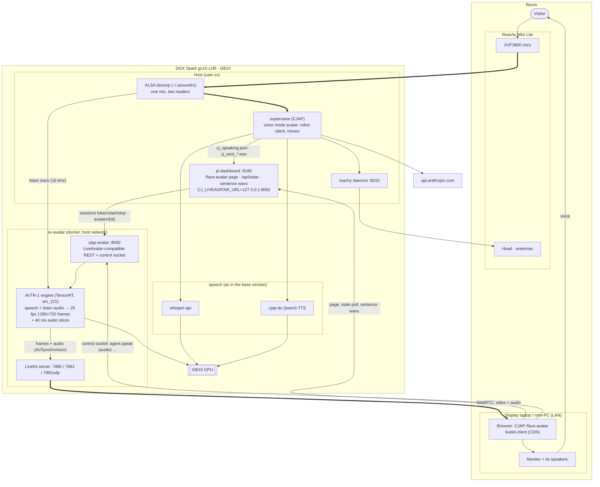
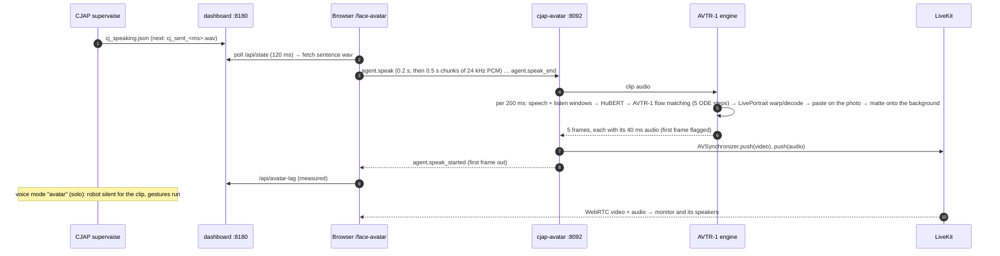

# CJAP on the DGX Spark, with a video avatar (alternative version)

> **Status:** Planned, not deployed. Written **2026-11-06**; the model changed from Ditto to **AVTR-1** the same day. Nothing here has run on the GB10. Runbook: [`CJAP_SPARK_AVATAR_RUNBOOK.md`](AVATAR_RUNBOOK.md).
> **What this version is:** [`CJAP_SPARK_ARCHITECTURE.md`](ARCHITECTURE.md) (CJAP on the Spark with a Reachy Mini Lite, Whisper STT, a Qwen3-TTS clone) **plus a talking-head video avatar** on a monitor, in place of the HeyGen LiveAvatar face CJAP already has. Everything that document says still holds; this one only adds the face.
> **Code:** branch **`spark/video-avatar`**, on top of `spark/local-speech`: `deploy/spark/avatar/` (the server, the engines, the image), a one-line-of-config change in `dashboard/ui_page_face.py`, and `tests/test_spark_avatar.py`.
> **The model:** **AVTR-1** (Goodsize / avaturn.live, `avaturn-live/avtr-1`), live from one photo, on TensorRT. It speaks **and listens**: it hears the visitor through the robot's microphone and reacts while they talk. **Wav2Lip** is the fallback for internal tests only (its weights are non-commercial). **No talking-head model has published speed numbers on a DGX Spark; the speed gate decides.**

---

## Contents

1. [What changes](#1-what-changes)
2. [What you decided](#2-what-you-decided)
3. [The model](#3-the-model)
4. [Architecture](#4-architecture)
5. [Replacing LiveAvatar](#5-replacing-liveavatar)
6. [The engines](#6-the-engines)
7. [Sound, sync, listening and interruptions](#7-sound-sync-listening-and-interruptions)
8. [GPU, memory and latency](#8-gpu-memory-and-latency)
9. [Licences](#9-licences)
10. [Security and privacy](#10-security-and-privacy)
11. [Risks](#11-risks)
12. [Open items](#12-open-items)
13. [Sources](#13-sources)

---

## 1. What changes

| | Base version | This version |
|---|---|---|
| Face | Reachy Mini head and antennas only | **Plus** a lip-synced face of Justice Panganiban on a monitor next to the robot, which also reacts while the visitor talks |
| Where the face comes from | — (CJAP's LiveAvatar page left unconfigured) | **AVTR-1 on the Spark's GPU**, streamed by a local LiveKit server to CJAP's existing `/face-avatar` page |
| Who plays the voice | The robot's speaker | **The monitor's speaker**, in sync with the lips (CJAP voice mode "avatar"); the robot stays silent and moves |
| CJAP code | as on `spark/local-speech` | the same, plus `CJ_LIVEAVATAR_URL` (the LiveAvatar API address becomes a setting) |
| New on the Spark | — | compose project **`sv-avatar`**: `livekit` (LiveKit server 1.13.11) and `cjap-avatar` (the server + AVTR-1), which also reads the robot's microphone through the shared ALSA capture |
| New next to the robot | — | a laptop or mini-PC with a browser, on the same LAN, driving the monitor (HDMI) and its speakers |

The pipeline stages from your original list now all run on the Spark except Claude: (1) Whisper, (2) Claude (CJAP's router and composer), (3) Qwen3-TTS, **(4) AVTR-1**, instead of OpenAI, Claude, ElevenLabs/Fish and HeyGen.

---

## 2. What you decided

| Question | Your answer |
|---|---|
| Integration | **Imitate the LiveAvatar API**: CJAP's page and dashboard are unchanged; a local server answers their calls |
| Display | **A laptop or mini-PC browser** on the LAN opens `/face-avatar` and mirrors to the monitor |
| Voice | **Monitor speaker** (CJAP's "avatar" voice mode): voice and lips leave in one stream |
| Model | **AVTR-1, live** (2026-11-06: "swap out Ditto, use AVTR-1"; Ditto was the first choice) |
| Speed uncertainty | **A speed gate and one fallback** (Wav2Lip) |
| Portrait | **Decide later**: the runbook takes any photo |

Everything else as decided for the base version (Lite on USB-C, Whisper, Claude as CJAP has it, the local voice clone from the real recording, robot mode stops Qwen).

---

## 3. The model

From the research of 2026-11-04 and 2026-11-06 and AVTR-1's repository (sources in §13). **Speeds on the Spark are estimates** scaled from published GPUs: the GB10 sits between an RTX 4060 Ti and a 5070 for this work.

| Model | From | Look | Published speed | Spark (estimate) | Spark evidence | Licence |
|---|---|---|---|---|---|---|
| **AVTR-1** (chosen) | one photo | whole head, 1280×720, speaks **and listens** (a second audio track drives reactions), idles by itself | per 5-frame (200 ms) chunk: L40 84 ms, A100 91 ms, RTX 4060 Ti 166 ms, L4 202 ms | 130–200 ms per chunk (0.9–1.5× real time) | none; its renderer is Ditto's LivePortrait models, which **were** built on a Spark | renderer **PolyForm Noncommercial**; weights AVTR-1 Community (commercial under USD 10M revenue) |
| Ditto (first choice) | one photo | whole head, 512 render pasted on the photo | A100 online RTF 0.895 | ~25 fps at 10 steps, unproven | built on a Spark (TensorRT 10.14.1) | code Apache-2.0; face models non-commercial / unclear |
| MuseTalk 1.5 | base video | 256×256 mouth over a loop | 72 fps RTX 4090 | 18–27 fps | build deps work on a Spark | MIT, commercial OK |
| SoulX-FlashHead Lite | one photo | best quality per compute | 96 fps RTX 4090 (paper) | 0.75–1.25× real time, 1.5–2 s first chunk | none | Apache-2.0 (VAE Open-RAIL-M) |
| Wav2Lip 256 (fallback) | base video | mouth only, lower quality | 60 fps RTX 3060 | 50–80 fps | plain PyTorch | **non-commercial** (original); 256 weights unlicensed |

**Why AVTR-1:**
- It is the only model that **listens**: given the visitor's audio as a second track, it nods and reacts while they talk, and idles naturally in between. That is the closest thing to a video call with a person.
- **Short lookahead:** a frame needs only 200 ms of audio after it (Ditto needed ~0.9 s), so the face starts sooner and interrupts settle faster.
- **Published per-chunk timings** on GPUs in the GB10's class (4060 Ti: 166 ms of a 200 ms budget).
- Its renderer uses **Ditto's LivePortrait ONNX models and the same GridSample3D TensorRT plugin**, so the Spark port's recipe for Ditto (TensorRT 10.14.1, the plugin rebuilt for sm_121) carries over.

**Its costs:** the packaging is x86 and pins TensorRT ≤ 10.12, torch < 2.8 and CUDA 12.8 (we re-pin to TensorRT 10.14.1, torch 2.11 cu130); the repository is young (2 commits, "production back-end coming soon"); the weights are gated on HuggingFace (an account accepts the licence); the renderer is noncommercial-only (§9). **The open question is speed**: Gate X2 measures it before anything depends on it.

---

## 4. Architecture

### On the Spark and next to the robot

- **The page does the routing.** CJAP's `/face-avatar` page already fetches each sentence's wav from the dashboard and sends it to the avatar over the control socket. Nothing on CJAP's app side changes.
- **One stream for voice and lips.** The engine returns each video frame with its own 40 ms of audio; LiveKit publishes both in one stream, and the browser plays them together.
- **One microphone, two readers.** The Spark's `~/.asoundrc` already shares the robot's mic through an ALSA `dsnoop`; CJAP keeps reading it as before, and the avatar container reads the same beam for its listen track.
- **Host networking** for both containers: the browser reaches LiveKit and the control socket at `192.168.1.201` directly.

### One sentence

---

## 5. Replacing LiveAvatar

CJAP integrates LiveAvatar's LITE mode at one seam (read from `dashboard/ui_page_face.py`): the dashboard calls the REST API, the page joins the LiveKit room the API returns and drives the avatar over a WebSocket. `cjap-avatar` answers exactly those calls:

| Call | Who | LiveAvatar | cjap-avatar |
|---|---|---|---|
| `POST /v1/sessions/token` `{mode, avatar_id, is_sandbox}`, `X-API-KEY` | dashboard | a session token | the same; checks key and avatar id |
| `POST /v1/sessions/start`, Bearer | dashboard | `livekit_url`, `livekit_client_token`, `ws_url` | joins its own LiveKit room, starts publishing, returns the same three |
| `POST /v1/sessions/stop` | dashboard | ends the session | leaves the room |
| `GET /v1/avatars/{id}` | `/maintain` | name, status, preview | name "Panganiban (Spark)", ACTIVE |
| socket ← `agent.speak` / `agent.speak_end` | page | lip-syncs our audio | the same, with AVTR-1 |
| socket ← `agent.interrupt` | page | stops | mutes at once, settles (§7) |
| socket ← `agent.start_listening` / `stop_listening` | page | listening pose | accepted; AVTR-1 listens to the robot's mic by itself (§7) |
| socket → `session.state_updated connected`, `agent.speak_started`, keep-alive replies | page | | the same |

**CJAP changes:** `dashboard/ui_page_face.py` reads the API address from **`CJ_LIVEAVATAR_URL`** (default `https://api.liveavatar.com`, so alpha is unchanged); the Spark's `pi-dashboard.service` sets it to `http://127.0.0.1:8092`. The dashboard's avatar config `dashboard/assets/liveavatar.json` holds the local key and avatar id, with `sandbox: false` (CJAP only shares the portrait from non-sandbox avatars).

**What stays as CJAP built it:** the voice-mode switch, the lag measurement, the robot hold, the readiness wait, the single-session guard, the still portrait (`FaceAnim`) and the idle park, the plaques and the state pill. They were written for LiveAvatar and never verified on a live session (CJAP's notes); this version is their first real test.

---

## 6. The engines

| Engine | Use | How |
|---|---|---|
| **`avtr1`** | live, primary | AVTR-1's `Pipeline` from `avaturn-live/avtr-1 @ eb1e5a8`, its TensorRT engines (renderer, HuBERT, AVTR-1 encode/decode) built on the Spark from the published weights, GridSample3D plugin compiled for sm_121. 5 ODE steps, guidance 2.0 / 2.0, 1280×720 |
| `wav2lip` | fallback, **internal tests only** | LiveTalking's Wav2Lip 256 over an 8 s base clip of the portrait that AVTR-1 makes once, offline (`make_base_video.py`, `prepare_wav2lip.py`) |
| `still` | plumbing test | the photo, audio passed through; proves LiveKit, the page and sync with no model |

**AVTR-1, driven live** (`deploy/spark/avatar/engines/avtr1.py`):
- **Two endless 16 kHz streams.** *Speech*: the clip audio when there is some, silence otherwise. *Listen*: the robot's microphone (`engines/listen.py`, `arecord` on the shared beam) while the face is silent, silence while it speaks. With both silent the head idles and blinks.
- **200 ms at a time.** Each call takes a 6480-sample window and returns 5 frames for its first 200 ms, so a frame needs **200 ms of audio after it**. The stream starts with 25 ms of extra silence to cover the resampler's buffering; the cost is that the lips trail the voice by about 30 ms, below what people notice.
- **A ledger** pairs every frame with the 40 ms of audio it was made from, so lips and voice leave together, and flags each clip's first frame (`agent.speak_started`).
- **Output** is I420 (YUV 4:2:0), which LiveKit takes as it is (no colour conversion).
- **The photo** is registered once at start (face detection, landmarks, appearance: ONNX Runtime on the GPU). The person is matted off the photo and put on a background: one of AVTR-1's ten (`plain_white` by default) or your own PNG.

**Knobs** (compose environment): `AVATAR_AVTR1_STEPS` (5; 4 or 3 is faster), `AVATAR_CFG_SELF` / `AVATAR_CFG_OTHER` (2.0 / 2.0: how strongly speech / listening drive the motion), `AVATAR_BG`, `AVATAR_W` / `AVATAR_H` (1280 / 720; 960 / 540 is cheaper), `AVATAR_LISTEN_PCM` (empty turns listening off), `AVATAR_LISTEN_GAIN`.

---

## 7. Sound, sync, listening and interruptions

- **Voice mode "avatar"** (CJAP's `solo`): the robot's speaker is silent while each clip plays on the monitor; the robot still moves (gestures, breathing). Set on `/maintain` → avatar card → voice.
- **Sync:** each 25 fps video frame is pushed together with its 960-sample audio slice through LiveKit's `AVSynchronizer`; camera and microphone tracks share one stream, so the browser plays them together. This is the approach the research found most reliable; a separate speaker would need an offset and drifts.
- **Listening:** the listen track is the robot's XMOS beam (`reachymini_audio_src_left`, the same dsnoop CJAP reads), so the face reacts to the visitor while they ask. It is **muted while the face speaks and for 1.5 s after**: the monitor isn't in the XVF3800's echo reference, so the mic hears the face's own voice, and the face shouldn't "listen" to itself. If the mic can't be opened, the face listens to silence and still idles (logged once).
- **Echo cancellation can't hear the monitor.** That matters for **the stop phrase** ("Cee-Jap" during an answer): if the face's own voice trips it, the runbook turns the stop phrase off for this mode (`CJ_STOP_WORD_ENABLED=0`) and the operator's Interrupt button remains. Point the monitor's speakers away from the robot, and keep their volume moderate.
- **Interrupt:** on `agent.interrupt` the server drops queued audio and mutes every frame already rendered, so **the voice stops at once and the mouth settles within about 0.4 s** (the frames already in the 200 ms pipeline and the jitter buffer).
- **Between answers:** the page shows CJAP's still portrait and opens the live face when a question starts (its existing pre-start); the local server costs nothing while idle, so the 45 s park can stay.

---

## 8. GPU, memory and latency

| In robot mode | Memory (estimate) | GPU load |
|---|---|---|
| AVTR-1 (TensorRT engines: HuBERT, AVTR-1 encode/decode, warp, decoder, stitch, MODNet) | ~4–6 GiB | **the heaviest load on the box**: one 5-frame chunk every 200 ms, continuously |
| cjap-tts (Qwen3-TTS) | ~6–8 GiB | bursts per sentence |
| whisper-api | ~6–8 GiB | one burst per question |
| LiveKit, the server, VP8 encoding of 1280×720 (CPU) | < 1 GiB | CPU only (the stock LiveKit wheel has no NVENC) |

- Qwen stays stopped in robot mode; memory is not the limit (~90 GB free), **the GPU is**. Gate X2 runs AVTR-1 alone and again while the TTS bench runs; the **95th-percentile chunk time must stay under 200 ms** (that is 25 fps).
- **End of question → first sound:** as in the base version up to the first sentence (STT ~0.4–1.0 s, Claude, TTS ~1–1.8 s), then **+0.5–0.9 s** for the face (200 ms lookahead, one chunk of compute, the 320 ms jitter buffer; estimate). Expect roughly **4.5–6.5 s** from the visitor's last word to the face speaking; CJAP's filler clips (also played through the face) bridge the wait.

---

## 9. Licences

**Check with counsel before a public or paid exhibit.** From AVTR-1's `LICENSE.md`, `THIRD-PARTY-NOTICES.md` and the research:

| Part | Licence |
|---|---|
| AVTR-1 renderer (`src/avtr1_renderer/`, the inference pipeline we run) | **PolyForm Noncommercial 1.0.0**: noncommercial use only, whatever the revenue; commercial use needs a Renderer Commercial License |
| AVTR-1 weights and build scripts | AVTR-1 Community License: commercial use allowed for entities under USD 10M annual revenue |
| AVTR-1 streamer (`src/avaturn_live_streamer/`) | PolyForm Noncommercial; **not used** (our server and LiveKit replace it) |
| Face analysis at setup: InsightFace SCRFD detector and 2D106 landmarks | **non-commercial research only** (AVTR-1 suggests MediaPipe as a replacement) |
| LivePortrait-derived renderer models (from Ditto's HuggingFace repo) | MIT (LivePortrait) |
| HuBERT (fine-tuned), MODNet, the GridSample3D plugin | Apache-2.0 |
| Wav2Lip (fallback) | **non-commercial**; LiveTalking's 256 weights ship with no licence |
| LiveKit server and SDKs | Apache-2.0 |
| The portrait | needs the subject's consent, like the voice |

PolyForm Noncommercial also allows use by charitable, educational, public-research and government organisations; whether CJAP's exhibit falls under that is a question for counsel. The face-analysis models run only once, when the photo is registered. That doesn't change their licence.

---

## 10. Security and privacy

- **Ports on the LAN:** 7880 (LiveKit signalling), 7881/tcp, 7882/udp (media), 8092 (control socket and REST). Only on the office LAN; no port forward on the router.
- **Keys:** `~/robot/avatar/avatar.env` and `livekit.yaml` (mode 600, generated by the runbook): the avatar API key (also in CJAP's `liveavatar.json`, mode 600), the avatar id, the LiveKit key and secret. Session tokens are random per session; the control socket refuses any other.
- **The HuggingFace token** (read-only, for AVTR-1's gated weights) sits in `~/robot/avatar/hf.token` (mode 600), entered at a hidden prompt, and is passed only to the one-time download step. The running server works offline (`HF_HUB_OFFLINE=1`).
- **The microphone:** the avatar container gets `/dev/snd`, the `audio` group and the host's IPC namespace (for the shared capture). It reads the room's audio into memory for the model and stores none of it. `AVATAR_LISTEN_PCM=""` turns this off.
- **The display laptop** needs internet for `livekit-client` (the page loads it from a CDN, unchanged).
- **The photo** is a person's likeness: `~/robot/avatar` is mode 700.

---

## 11. Risks

| # | Risk | Impact | Mitigation |
|---|---|---|---|
| V1 | AVTR-1 above 200 ms per chunk on the GB10, especially with TTS running | 🔴 stutter | Gate X2; 4 or 3 ODE steps; 960×540; the Wav2Lip fallback (internal) |
| V2 | The TensorRT build: apt package version, the plugin, AVTR-1's engine scripts under TensorRT 10.14 (upstream pins ≤ 10.12) | 🟠 | Pinned versions; the Ditto-on-Spark recipe for the shared parts; incident rows |
| V3 | AVTR-1's engine export uses torch's legacy TorchScript ONNX exporter (deprecated in torch 2.9+, still in 2.11) | 🟠 | Incident row: export with an older torch in a throwaway environment |
| V4 | ONNX Runtime's CUDA provider (photo registration) on sm_121 | 🟡 | `onnxruntime-gpu` 1.31.1 (CUDA 13, aarch64 wheel); checked in X3 |
| V5 | The monitor's voice trips the stop phrase | 🟠 cut answers | Speakers away from the robot; `CJ_STOP_WORD_ENABLED=0` |
| V6 | ~0.5–0.9 s face start lag | 🟡 | Measured by the page; fillers bridge it |
| V7 | CJAP's LiveAvatar page logic has never run against a live session | 🟠 | Gate X1 with the `still` engine before AVTR-1 |
| V8 | AVTR-1's renderer is noncommercial; InsightFace models | 🟠 | §9; counsel |
| V9 | LiveKit WebRTC across the LAN (multi-NIC Spark, Wi-Fi laptop) | 🟡 | `node_ip` and `ips.includes` pinned to 192.168.1.0/24; Gate X1 |
| V10 | The shared mic from a container (dsnoop over host IPC) | 🟡 | If it fails the face listens to silence (still idles); log line; X8 checks it |
| V11 | A young repository (2 commits) and weights on the `main` revision | 🟡 | Code pinned by commit; the weights' revision on 2026-11-06 was `4c9bd55`; the downloaded copy stays in `~/models/avtr1` |

---

## 12. Open items

| # | Item | Owner |
|---|---|---|
| 1 | The portrait photo (front-facing, even light, face ≥ 256 px, consent) and the background | You |
| 2 | A HuggingFace account that accepts AVTR-1's licence, and a read token | You |
| 3 | Counsel on AVTR-1's noncommercial renderer, InsightFace and a public exhibit | You |
| 4 | The display laptop/mini-PC and monitor; where its speakers point | You |
| 5 | Later: NVENC for LiveKit (custom build); replace InsightFace with MediaPipe for commercial use | Later |

---

## 13. Sources

- CJAP: [`dashboard/ui_page_face.py`](https://github.com/Supervaise-Inc/CJAP/blob/merge/master-single-robot/dashboard/ui_page_face.py) (LiveAvatar session, page, control socket), [`docs/SYSTEM_TRACE.md`](https://github.com/Supervaise-Inc/CJAP/blob/merge/master-single-robot/docs/SYSTEM_TRACE.md), `docs/handover-notes/avatar_notes.docx`, `display_notes.docx`
- AVTR-1: [repo](https://github.com/avaturn-live/avtr-1) (README, `pixi.toml`, `LICENSE.md`, `THIRD-PARTY-NOTICES.md`, `src/avtr1_renderer/pipeline.py`, `types.py`, `scripts/generate_offline.py`, `scripts/build_*.py`), [weights](https://huggingface.co/avaturn-live/avtr-1), [project page](https://avaturn-live.github.io/avtr-1-projectpage/)
- Shared with Ditto: [Ditto's ONNX models](https://huggingface.co/digital-avatar/ditto-talkinghead), [DGX Spark ARM64 TensorRT port of Ditto](https://blog.mikihands.com/en/whitedec/2026/3/3/ditto-talkinghead-dgx-spark-arm64-tensorrt-porting/), [GridSample3D plugin](https://github.com/SeanWangJS/grid-sample3d-trt-plugin), [TensorRT 10.14.1 notes](https://docs.nvidia.com/deeplearning/tensorrt/latest/getting-started/release-notes-10/10.14.1.html)
- Runtime: [onnxruntime-gpu 1.31.1](https://pypi.org/project/onnxruntime-gpu/1.31.1/) (aarch64 wheel, CUDA 13), [torch.onnx.export in 2.11](https://github.com/pytorch/pytorch/blob/v2.11.0/torch/onnx/__init__.py)
- Others compared: [Ditto](https://github.com/antgroup/ditto-talkinghead), [SoulX-FlashHead](https://github.com/Soul-AILab/SoulX-FlashHead), [MuseTalk](https://github.com/TMElyralab/MuseTalk), [LiveTalking (Wav2Lip 256)](https://github.com/lipku/LiveTalking), [Wav2Lip](https://github.com/Rudrabha/Wav2Lip), [LAM](https://github.com/aigc3d/LAM)
- LiveKit: [server](https://github.com/livekit/livekit), [Python SDKs](https://github.com/livekit/python-sdks), [A/V sync note](https://kb.livekit.io/articles/3726353370-debugging-audio-video-sync-issues-in-livekit-publishing)
- The base design: [`CJAP_SPARK_ARCHITECTURE.md`](ARCHITECTURE.md)
