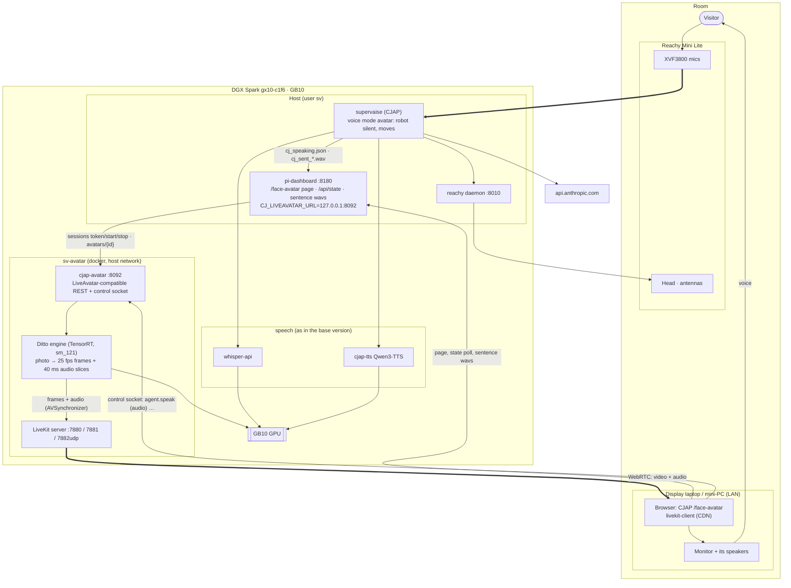
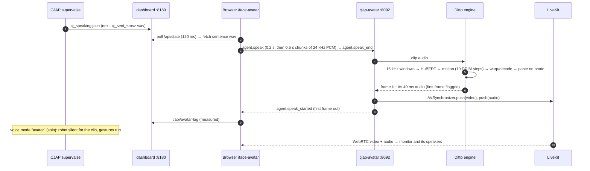

# CJAP on the DGX Spark, with a video avatar (alternative version)

> **Status:** Planned, not deployed. Written **2026-11-06**. Nothing here has run on the GB10. Runbook: [`CJAP_SPARK_AVATAR_RUNBOOK.md`](AVATAR_RUNBOOK.md).
> **What this version is:** [`CJAP_SPARK_ARCHITECTURE.md`](ARCHITECTURE.md) (CJAP on the Spark with a Reachy Mini Lite, Whisper STT, a Qwen3-TTS clone) **plus a talking-head video avatar** on a monitor, in place of the HeyGen LiveAvatar face CJAP already has. Everything that document says still holds; this one only adds the face.
> **Code:** branch **`spark/video-avatar`**, one commit on top of `spark/local-speech`: `deploy/spark/avatar/` (the server, the engines, the image), a one-line-of-config change in `dashboard/ui_page_face.py`, and `tests/test_spark_avatar.py`.
> **The model:** **Ditto** (Ant Group, `antgroup/ditto-talkinghead`), live from one photo, on TensorRT. **Wav2Lip** is the fallback for internal tests only (its weights are non-commercial). **No talking-head model has published speed numbers on a DGX Spark; the speed gate decides.**

---

## Contents

1. [What changes](#1-what-changes)
2. [What you decided](#2-what-you-decided)
3. [The model](#3-the-model)
4. [Architecture](#4-architecture)
5. [Replacing LiveAvatar](#5-replacing-liveavatar)
6. [The engines](#6-the-engines)
7. [Sound, sync and interruptions](#7-sound-sync-and-interruptions)
8. [GPU, memory and latency](#8-gpu-memory-and-latency)
9. [Licences](#9-licences)
10. [Security](#10-security)
11. [Risks](#11-risks)
12. [Open items](#12-open-items)
13. [Sources](#13-sources)

---

## 1. What changes

| | Base version | This version |
|---|---|---|
| Face | Reachy Mini head and antennas only | **Plus** a lip-synced face of Justice Panganiban on a monitor next to the robot |
| Where the face comes from | — (CJAP's LiveAvatar page left unconfigured) | **Ditto on the Spark's GPU**, streamed by a local LiveKit server to CJAP's existing `/face-avatar` page |
| Who plays the voice | The robot's speaker | **The monitor's speaker**, in sync with the lips (CJAP voice mode "avatar"); the robot stays silent and moves |
| CJAP code | as on `spark/local-speech` | the same, plus `CJ_LIVEAVATAR_URL` (the LiveAvatar API address becomes a setting) |
| New on the Spark | — | compose project **`sv-avatar`**: `livekit` (LiveKit server 1.13.11) and `cjap-avatar` (the server + Ditto) |
| New next to the robot | — | a laptop or mini-PC with a browser, on the same LAN, driving the monitor (HDMI) and its speakers |

The pipeline stages from your original list now all run on the Spark except Claude: (1) Whisper, (2) Claude (CJAP's router and composer), (3) Qwen3-TTS, **(4) Ditto**, instead of OpenAI, Claude, ElevenLabs/Fish and HeyGen.

---

## 2. What you decided

| Question | Your answer |
|---|---|
| Integration | **Imitate the LiveAvatar API**: CJAP's page and dashboard are unchanged; a local server answers their calls |
| Display | **A laptop or mini-PC browser** on the LAN opens `/face-avatar` and mirrors to the monitor |
| Voice | **Monitor speaker** (CJAP's "avatar" voice mode): voice and lips leave in one stream |
| Model | **Ditto, live** |
| Speed uncertainty | **A speed gate and one fallback** (Wav2Lip) |
| Portrait | **Decide later**: the runbook takes any photo |

Everything else as decided for the base version (Lite on USB-C, Whisper, Claude as CJAP has it, the local voice clone from the real recording, robot mode stops Qwen).

---

## 3. The model

From the research of 2026-11-06 (sources in §13). **Speeds on the Spark are estimates** scaled from published GPUs: the GB10 sits between an RTX 4060 Ti and a 5070 for this work.

| Model | From | Look | Published speed | Spark (estimate) | Spark evidence | Licence |
|---|---|---|---|---|---|---|
| **Ditto** (chosen) | one photo | whole head: lips, head motion, blinks, gaze; 512 render pasted on the photo | A100 online RTF 0.895, first frame 385 ms; RTX 4090 online RTF ≈ 0.5 | ~13–17 fps at 50 steps; **the live config uses 10 steps** (paper: "comparable quality"), so likely near or above 25 fps, unproven | **The only model built on a Spark** (TensorRT 10.14.1, CUDA 13.1, rebuilt GridSample3D plugin); no fps published | code Apache-2.0; face-analysis models InsightFace (non-commercial); some weights' licence unanswered upstream |
| AVTR-1 | one photo | whole head, listens and idles by itself, 720p | 1.2× real time on RTX 4060 Ti | 0.9–1.3× | none; x86-only packaging | renderer PolyForm **Noncommercial** |
| MuseTalk 1.5 | base video | 256×256 mouth over a loop | 72 fps RTX 4090 | 18–27 fps | build deps work on a Spark | MIT, commercial OK |
| SoulX-FlashHead Lite | one photo | best quality per compute | 96 fps RTX 4090 (paper) | 0.75–1.25× real time, 1.5–2 s first chunk | none | Apache-2.0 (VAE Open-RAIL-M) |
| Wav2Lip 256 (fallback) | base video | mouth only, lower quality | 60 fps RTX 3060 | 50–80 fps | plain PyTorch | **non-commercial** (original); 256 weights unlicensed |

**Why Ditto:** one photo is enough, the whole head moves, idle and blinking come from the same model, and it is the only candidate somebody has already built for the GB10. **The open question is speed**; Gate X2 measures it before anything depends on it.

---

## 4. Architecture

### On the Spark and next to the robot

- **The page does the routing.** CJAP's `/face-avatar` page already fetches each sentence's wav from the dashboard and sends it to the avatar over the control socket. Nothing on CJAP's app side changes.
- **One stream for voice and lips.** The engine returns each video frame with its own 40 ms of audio; LiveKit publishes both in one stream, and the browser plays them together.
- **Host networking** for both containers: the browser reaches LiveKit and the control socket at `192.168.1.201` directly.

### One sentence

---

## 5. Replacing LiveAvatar

CJAP integrates LiveAvatar's LITE mode at one seam (read from `dashboard/ui_page_face.py`): the dashboard calls the REST API, the page joins the LiveKit room the API returns and drives the avatar over a WebSocket. `cjap-avatar` answers exactly those calls:

| Call | Who | LiveAvatar | cjap-avatar |
|---|---|---|---|
| `POST /v1/sessions/token` `{mode, avatar_id, is_sandbox}`, `X-API-KEY` | dashboard | a session token | the same; checks key and avatar id |
| `POST /v1/sessions/start`, Bearer | dashboard | `livekit_url`, `livekit_client_token`, `ws_url` | joins its own LiveKit room, starts publishing, returns the same three |
| `POST /v1/sessions/stop` | dashboard | ends the session | leaves the room |
| `GET /v1/avatars/{id}` | `/maintain` | name, status, preview | name "Panganiban (Spark)", ACTIVE |
| socket ← `agent.speak` / `agent.speak_end` | page | lip-syncs our audio | the same, with Ditto |
| socket ← `agent.interrupt` | page | stops | mutes at once, settles (§7) |
| socket ← `agent.start_listening` / `stop_listening` | page | listening pose | accepted; Ditto idles on silence |
| socket → `session.state_updated connected`, `agent.speak_started`, keep-alive replies | page | | the same |

**CJAP changes:** `dashboard/ui_page_face.py` reads the API address from **`CJ_LIVEAVATAR_URL`** (default `https://api.liveavatar.com`, so alpha is unchanged); the Spark's `pi-dashboard.service` sets it to `http://127.0.0.1:8092`. The dashboard's avatar config `dashboard/assets/liveavatar.json` holds the local key and avatar id, with `sandbox: false` (CJAP only shares the portrait from non-sandbox avatars).

**What stays as CJAP built it:** the voice-mode switch, the lag measurement, the robot hold, the readiness wait, the single-session guard, the still portrait (`FaceAnim`) and the idle park, the plaques and the state pill. They were written for LiveAvatar and never verified on a live session (CJAP's notes); this version is their first real test.

---

## 6. The engines

| Engine | Use | How |
|---|---|---|
| **`ditto`** | live, primary | `StreamSDK` (online) from `antgroup/ditto-talkinghead @ c3e47ee`, TensorRT engines built on the Spark from the published ONNX, GridSample3D plugin compiled for sm_121. 10 sampling steps, `overlap_v2=70`, emotion neutral |
| `wav2lip` | fallback, **internal tests only** | LiveTalking's Wav2Lip 256 over an 8 s base clip of the portrait that Ditto makes once, offline (`make_base_video.py`, `prepare_wav2lip.py`) |
| `still` | plumbing test | the photo, audio passed through; proves LiveKit, the page and sync with no model |

**Ditto, driven live** (`deploy/spark/avatar/engines/ditto.py`):
- One endless 16 kHz stream: the clip audio when there is some, **silence otherwise**. Silence gives a calm idle head; **blinks** come from Ditto's own eye template every 60–100 frames.
- Ditto emits frame *k* only with ~0.88 s of audio after it. The engine keeps 28 frames (1.12 s) in flight, so **a sentence starts on screen ~1.1–1.3 s after its audio reaches the server** (estimate). The page measures it (`agent.speak_started`), and since the robot is silent in "avatar" mode, nothing waits on it except the visitor.
- A ledger pairs every emitted frame with the 40 ms of audio it was made from, so lips and voice leave together.
- The source photo is registered once at start (face analysis models run only then).

**Speed knobs** (compose environment): `AVATAR_DITTO_STEPS` (10; fewer is faster), `AVATAR_DITTO_OVERLAP` (70; 75 halves the lag but doubles the motion-model calls), `AVATAR_DITTO_AHEAD` (28 frames in flight).

---

## 7. Sound, sync and interruptions

- **Voice mode "avatar"** (CJAP's `solo`): the robot's speaker is silent while each clip plays on the monitor; the robot still moves (gestures, breathing). Set on `/maintain` → avatar card → voice.
- **Sync:** each 25 fps video frame is pushed together with its 960-sample audio slice through LiveKit's `AVSynchronizer`; camera and microphone tracks share one stream, so the browser plays them together. This is the approach the research found most reliable; a separate speaker would need an offset and drifts.
- **Echo cancellation can't hear the monitor.** The XVF3800 cancels only the robot's own speaker. While the monitor speaks, the robot's microphone hears it. That matters for **the stop phrase** ("Cee-Jap" during an answer): if the face's own voice trips it, the runbook turns the stop phrase off for this mode (`CJ_STOP_WORD_ENABLED=0`) and the operator's Interrupt button remains. Point the monitor's speakers away from the robot, and keep their volume moderate.
- **Interrupt:** Ditto can't recall frames already in its pipeline. On `agent.interrupt` the server drops queued audio, mutes every frame already rendered and feeds silence, so **the voice stops at once and the mouth settles within about a second**. A cleaner cut needs a patch to Ditto's motion worker (open item).
- **Between answers:** the page shows CJAP's still portrait and opens the live face when a question starts (its existing pre-start); the local server costs nothing while idle, so the 45 s park can stay.

---

## 8. GPU, memory and latency

| In robot mode | Memory (estimate) | GPU load |
|---|---|---|
| Ditto (TensorRT engines, HuBERT, motion model, warp/decoder at 25 fps) | ~3–6 GiB | **the heaviest load on the box**: every frame, continuously |
| cjap-tts (Qwen3-TTS) | ~6–8 GiB | bursts per sentence |
| whisper-api | ~6–8 GiB | one burst per question |
| LiveKit, the server, VP8 encoding (CPU) | < 1 GiB | CPU only (the stock LiveKit wheel has no NVENC) |

- Qwen stays stopped in robot mode; memory is not the limit (~90 GB free), **the GPU is**. Gate X2 runs Ditto alone and again while the TTS bench runs; both must hold **≥ 25 fps** (aim 28).
- **End of question → first sound:** as in the base version up to the first sentence (STT ~0.4–1.0 s, Claude, TTS ~1–1.8 s), then **+1.1–1.3 s** for the face. Expect roughly **5–7 s** from the visitor's last word to the face speaking; CJAP's filler clips (also played through the face) bridge the wait.

---

## 9. Licences

**Check with counsel before a public or paid exhibit.** The research found:

| Part | Licence |
|---|---|
| Ditto code | Apache-2.0 |
| Ditto models: LivePortrait-derived parts | LivePortrait's licence (per the maintainer) |
| Ditto face analysis at setup: InsightFace detector and landmarks | **non-commercial research only** |
| Ditto `landmark203`, HuBERT terms | **unanswered upstream** (issues #84, #97, #98) |
| Wav2Lip (fallback) | **non-commercial**; LiveTalking's 256 weights ship with no licence |
| LiveKit server and SDKs | Apache-2.0 |
| The portrait | needs the subject's consent, like the voice |

The face-analysis models run only once, when the photo is registered. That doesn't change their licence.

---

## 10. Security

- **Ports on the LAN:** 7880 (LiveKit signalling), 7881/tcp, 7882/udp (media), 8092 (control socket and REST). Only on the office LAN; no port forward on the router.
- **Keys:** `~/robot/avatar/avatar.env` and `livekit.yaml` (mode 600, generated by the runbook): the avatar API key (also in CJAP's `liveavatar.json`, mode 600), the avatar id, the LiveKit key and secret. Session tokens are random per session; the control socket refuses any other.
- **The display laptop** needs internet for `livekit-client` (the page loads it from a CDN, unchanged).
- **The photo** is a person's likeness: `~/robot/avatar` is mode 700.

---

## 11. Risks

| # | Risk | Impact | Mitigation |
|---|---|---|---|
| V1 | Ditto below 25 fps on the GB10, especially with TTS running | 🔴 stutter | Gate X2; fewer steps; the Wav2Lip fallback (internal) |
| V2 | The TensorRT build: the apt package version, the plugin, engine conversion | 🟠 | Pinned versions; the Spark port blog's recipe; incident rows |
| V3 | cuda-python 13 import layout in Ditto | 🟡 | Patched at build, checked by `grep` in the Dockerfile |
| V4 | The monitor's voice trips the stop phrase | 🟠 cut answers | Speakers away from the robot; `CJ_STOP_WORD_ENABLED=0` |
| V5 | ~1.1–1.3 s face start lag | 🟡 | Measured by the page; fillers bridge it |
| V6 | Interrupts let the mouth move ~1 s silently | 🟡 | Accepted for v1; worker patch later |
| V7 | CJAP's LiveAvatar page logic has never run against a live session | 🟠 | Gate X1 with the `still` engine before Ditto |
| V8 | Licences of Ditto's face models | 🟠 | §9; counsel |
| V9 | LiveKit WebRTC across the LAN (multi-NIC Spark, Wi-Fi laptop) | 🟡 | `node_ip` and `ips.includes` pinned to 192.168.1.0/24; Gate X1 |
| V10 | One SDK per process (Ditto #62) | 🟡 | One engine in one container |

---

## 12. Open items

| # | Item | Owner |
|---|---|---|
| 1 | The portrait photo (front-facing, even light, ≥ 512 px face, consent) | You |
| 2 | Counsel on Ditto's face models and on a public exhibit | You |
| 3 | The display laptop/mini-PC and monitor; where its speakers point | You |
| 4 | Push `spark/video-avatar` with `spark/local-speech` (needs write access) | You / repo owner |
| 5 | Later: a clean interrupt (patch Ditto's motion worker); NVENC for LiveKit (custom build) | Later |

---

## 13. Sources

- CJAP: [`dashboard/ui_page_face.py`](https://github.com/Supervaise-Inc/CJAP/blob/merge/master-single-robot/dashboard/ui_page_face.py) (LiveAvatar session, page, control socket), [`docs/SYSTEM_TRACE.md`](https://github.com/Supervaise-Inc/CJAP/blob/merge/master-single-robot/docs/SYSTEM_TRACE.md), `docs/handover-notes/avatar_notes.docx`, `display_notes.docx`
- Ditto: [repo](https://github.com/antgroup/ditto-talkinghead), [paper](https://arxiv.org/html/2411.19509), [weights](https://huggingface.co/digital-avatar/ditto-talkinghead), [DGX Spark ARM64 TensorRT port](https://blog.mikihands.com/en/whitedec/2026/3/3/ditto-talkinghead-dgx-spark-arm64-tensorrt-porting/), [GridSample3D plugin](https://github.com/SeanWangJS/grid-sample3d-trt-plugin), [TensorRT 10.14.1 notes](https://docs.nvidia.com/deeplearning/tensorrt/latest/getting-started/release-notes-10/10.14.1.html)
- Others compared: [AVTR-1](https://github.com/avaturn-live/avtr-1), [SoulX-FlashHead](https://github.com/Soul-AILab/SoulX-FlashHead), [MuseTalk](https://github.com/TMElyralab/MuseTalk), [LiveTalking (Wav2Lip 256)](https://github.com/lipku/LiveTalking), [Wav2Lip](https://github.com/Rudrabha/Wav2Lip), [LAM](https://github.com/aigc3d/LAM), [OpenAvatarChat](https://github.com/HumanAIGC-Engineering/OpenAvatarChat), [avatar-harness](https://github.com/i25959341/avatar-harness)
- LiveKit: [server](https://github.com/livekit/livekit), [Python SDKs](https://github.com/livekit/python-sdks), [agents avatar module](https://github.com/livekit/agents), [A/V sync note](https://kb.livekit.io/articles/3726353370-debugging-audio-video-sync-issues-in-livekit-publishing)
- The base design: [`CJAP_SPARK_ARCHITECTURE.md`](ARCHITECTURE.md)
